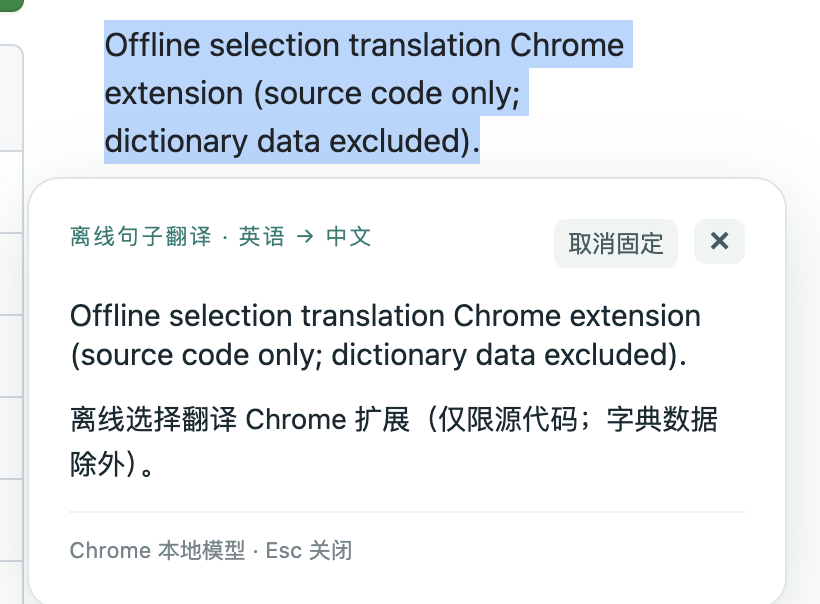
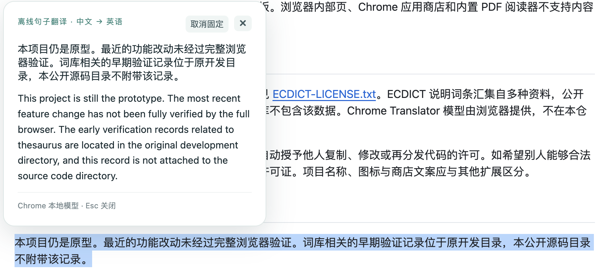

# Offline Selection Translator · 离线划词翻译

一个 Chrome 划词翻译扩展：选中网页中的英文或中文，在文字附近显示释义或译文。英文单词使用本地 ECDICT 词库查询；英汉句子互译使用 Chrome 内置 Translator 模型。词库与模型准备完成后，查询和翻译可在本机离线进行。

## 功能

- **划词查词与双向翻译**：英文单词优先显示本地词典释义；选中英文句子翻译成中文，选中纯中文翻译成英文。中英混合文本优先按英语 → 中文翻译。支持最多 3000 字符的选区。
- **可移动翻译浮层**：结果显示在选区附近；可拖动、固定位置，也可按 Esc 关闭。
- **网站白名单与限时黑名单**：从扩展工具栏直接把当前网站加入名单；黑名单可选永久、预设时长或自定义分钟数，到期自动恢复。
- **本地运行**：ECDICT 数据导入浏览器本地数据库；句子翻译使用 Chrome 下载到设备的语言模型。扩展不提供翻译服务器。

## 效果预览

| 英语 → 中文 | 中文 → 英语 |
| --- | --- |
|  |  |

> 截图展示了固定位置的翻译浮层。译文由 Chrome 本地模型生成，具体结果可能因浏览器模型版本而异。

## 源码与词库

本仓库只提供扩展源码和 ECDICT 转换脚本，**不包含词库数据**。克隆后需自行获取 ECDICT 并在本机生成 `data/`，才能使用离线查词。Chrome 的翻译语言包也需要首次下载。

## 本机准备词库

需要 Python 3.8+。从 [ECDICT 官方仓库](https://github.com/skywind3000/ECDICT) 获取 `ecdict.csv`，然后在项目根目录执行：

```sh
python3 tools/prepare_dictionary.py --csv /path/to/ecdict.csv
```

也可以明确让脚本从 ECDICT 官方仓库下载并转换：

```sh
python3 tools/prepare_dictionary.py --download
```

脚本用 Python 标准库解析 CSV，生成分片 JSON、词形索引和校验清单。生成的 `data/` 与下载缓存 `.cache/` 均被 `.gitignore` 排除。**不要将 `data/`、原始 CSV 或含词库的扩展打包文件上传到本仓库。** 当前脚本读取 ECDICT 的 `master` 分支，数据随上游更新可能变化；生成的 `data/manifest.json` 记录源 CSV 的内容哈希前 16 位。

## 在 Chrome 中加载

打开 `chrome://extensions`，启用开发者模式，选择「加载已解压的扩展程序」，选中本项目根目录。点击扩展图标，在「更多设置 / 词库管理」中首次导入生成的词库。安装或重新加载后刷新已打开的网页。

在工具栏快捷面板中，可把当前网站加入白名单、限时或永久黑名单，或调整浮层位置。句子翻译首次使用需要在面板中分别准备英中或中英模型；准备完成后可关闭面板。浏览器内部页、Chrome 应用商店和内置 PDF 阅读器不支持内容脚本划词。

## 数据与许可

词库来源为 [ECDICT](https://github.com/skywind3000/ECDICT)，其仓库标注 MIT 许可；原文见 [ECDICT-LICENSE.txt](ECDICT-LICENSE.txt)。ECDICT 说明词条汇集自多种资料，公开再分发词条前应自行核查上游数据权利。本源码仓库不包含该数据。Chrome Translator 模型由浏览器提供，不在本仓库分发。

本项目源码尚未另行指定开源许可证；公开仓库不自动授予他人复制、修改或再分发代码的许可。如希望别人能够合法复用代码，应在发布前自行选择并添加适合的项目许可证。项目名称、图标与商店文案应与其他扩展区分。

## 状态

本项目仍是原型。最近的功能改动未经过完整浏览器验证。词库相关的早期验证记录位于原开发目录，本公开源码目录不附带该记录。
